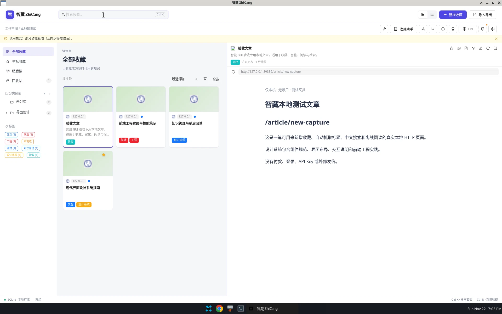
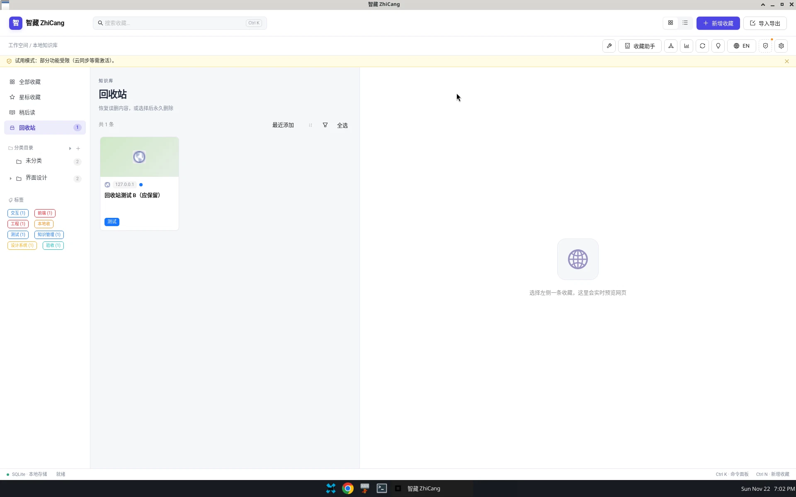

## GUI 验收补充 · 2026-11-22（Asia/Shanghai，UTC+8）

父会话通过 computerUse 在独立临时库实际操作，并提供原始截图；执行代理已读取这两张截图确认内容。以下是本次通过的范围，不扩展为其他未执行测试：

- 点击原有试用入口进入中文三栏工作台。
- 普通窗口与最大化状态无明显遮挡；尝试拖右下角没有改变尺寸，因此**任意尺寸缩放未验证**。
- 收藏真实本机 HTTP 页面 `http://127.0.0.1:39339/article/new-capture` 成功，并在右侧预览。
- 将标题编辑为“验收文章”、标签设为“验收”；中文标题搜索及标签筛选均命中。
- 移入回收站、恢复成功；只永久删除 A 后，B 仍保留。
- 未配置模型/Key 时明确降级为本地关键词模式，不伪造 AI 总结。
- 深色/浅色主题切换正常。

测试环境是源码构建产物启动的 Electron + 临时 userData/sessionData + 本机测试 HTTP 页面，不涉及真实账户。**这不是安装包启动、真实 AI、真实支付、线上授权或真实多设备同步的验收。** 验收后自有临时 GUI 与 HTTP 服务已精确结束，其他服务未操作；截图中的临时测试地址不再提供服务。

截图（原始文件直接复制，未修改图像）：

