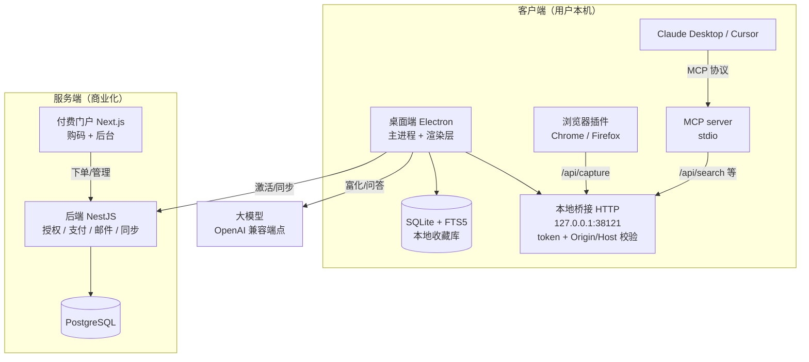
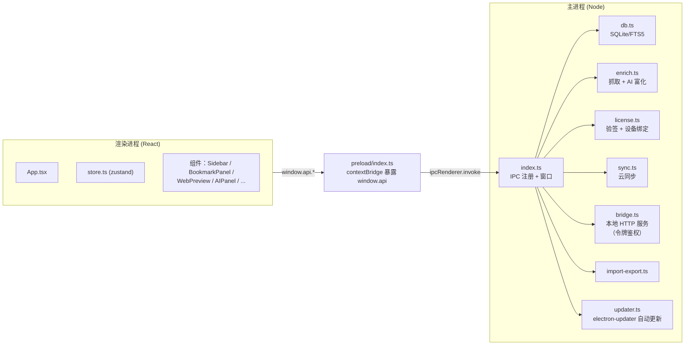

# 01 · 系统架构

## 总体架构

智藏由 5 个可独立运行的应用 + 1 个共享包组成，通过 pnpm workspace 管理。桌面端是核心，后端/门户负责商业化（授权与售卖），插件/MCP 通过本地桥接接入桌面端。

## Monorepo 与依赖

- 工作区定义：`pnpm-workspace.yaml`（`apps/*`、`packages/*`）。
- 共享类型与许可证验签集中在 `@zhicang/shared`，被桌面端、后端、门户复用，保证领域模型一致。
- 根 `package.json` 暴露聚合脚本：`dev:all` / `start:*` / `dist:desktop` / `deploy` / `build:extension`。
- 依赖布局采用 **hoisted**（根 `.npmrc` 设 `node-linker=hoisted`），以保证 electron-builder 能正确收集原生依赖（见 [wiki/10](./10-Build-And-Release.md)）。

## 桌面端进程模型

> 渲染层与主进程均**中/英双语**（React Context `i18n.tsx`），主进程更新弹窗读取持久化的 `settings.lang` 选择语言；详见 [wiki/03](./03-Desktop-App.md)。

- **主进程**：拥有数据库、网络抓取、AI 调用、授权、桥接服务等全部能力。
- **预加载层**：`contextBridge` 把分组化的 `window.api`（categories / bookmarks / ai / license / io ...）安全暴露给渲染层，禁用 nodeIntegration。
- **渲染层**：React + Ant Design，状态用 zustand（`store.ts`），所有数据操作经 `window.api` 走 IPC。

## 关键数据流

1. **新增收藏**：渲染层 `bookmarks.create` → IPC → 写库（`ai_state=pending`）→ 后台抓取 meta → AI 富化队列 → 通过 `on('bookmarks:changed')` 通知渲染层刷新。
2. **插件收藏**：浏览器插件 → `POST http://127.0.0.1:38121/api/capture` → 桥接 handler → 复用主进程入库 + 富化逻辑。
3. **AI 检索**：MCP / AI 面板 → `/api/search` 或 `ai:ask` → FTS5 命中（+ 可选 LLM 重排/问答）。
4. **授权激活**：渲染层 `license.activate(email, code)` → 后端 `/license/activate` 校验激活码 + 绑定设备 → 返回 RS256 许可证 JWT → 本地存储，启动时用内置公钥验签。
5. **云同步**：`sync.run` → 后端 `/sync`（按 email + urlHash 双向合并）。
6. **支付履约**：门户下单 → 后端按 `payment.provider` 创建 Stripe/支付宝/微信结算 → 用户付款 → 渠道回调 `/payment/webhook/{stripe,alipay,wechat}`（验签）→ 幂等 `fulfill` 生成激活码 + 发邮件。详见 [wiki/06](./06-Backend-And-Licensing.md)。

## 相关源码

- `pnpm-workspace.yaml`、`package.json`、`.npmrc`
- `apps/desktop/src/main/index.ts`（IPC 注册中心）
- `apps/desktop/src/preload/index.ts`（API 暴露）
- `apps/desktop/src/renderer/src/store.ts`（前端状态）
- `apps/desktop/src/main/updater.ts`（自动更新）、`apps/desktop/src/renderer/src/i18n.tsx`（i18n）
