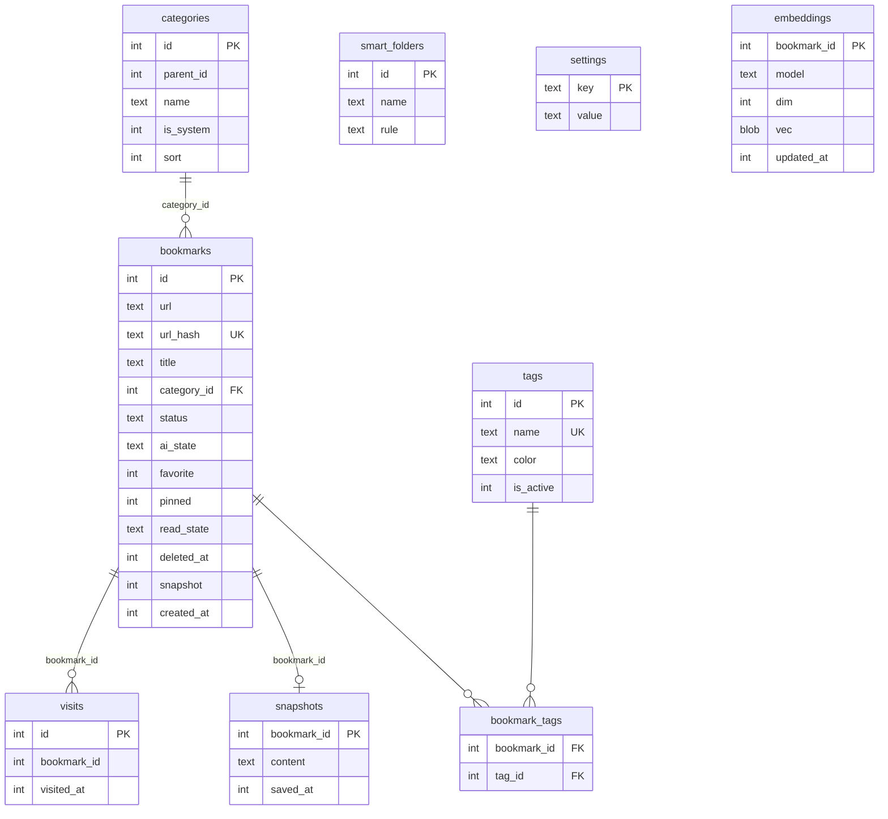

# 04 · 数据模型

数据模型分三处：桌面端本地 SQLite（收藏主数据）、后端 PostgreSQL/SQLite（账号与可选同步）、共享类型包（领域类型与契约）。

## 桌面端 SQLite（`apps/desktop/src/main/db.ts`）

本地库位于 Electron `userData/zhicang.db`，开启 WAL 与外键。迁移函数 `migrate()` 用 `CREATE TABLE IF NOT EXISTS` + `addColumnIfMissing` 做平滑增量升级。

### 关键表说明

- **bookmarks**：核心表。`url_hash` 唯一（去重）；软删除用 `deleted_at`；`ai_state` ∈ `pending/processing/done/failed/skipped`；`status` ∈ `active/dead/archived`；星标/置顶/已读/备注/访问计数/排序等均为后续增量列。
- **fts_bookmarks**：FTS5 虚拟表（`tokenize='unicode61'`），索引 `title/description/content_excerpt/url/tags`，支撑全文搜索；启动时若检测到旧的 `content=''` 外部内容表会重建为标准内容表以支持 DELETE/UPDATE。
- **smart_folders**：智能文件夹仅存规则（`rule` 为 JSON 的 `SmartFolderRule`），查询时动态过滤，不落实体关系。规则维度：关键词、标签（任一）、域名、分类、星标、已读状态、`status`（含 `dead` 失效链接）、`recentDays`（最近 N 天新增）、`hasAi`（是否已 AI 富化，对应 `ai_state='done'`）。
- **snapshots**：离线正文存档（图片内联 data URI 的完整 HTML）。
- **visits**：访问明细，用于统计热力图与「最常访问」。
- **settings**：键值表，存大模型配置、桥接端口、后端地址、设备盐、许可证 token、嵌入配置（key=`embedding`）、自动同步开关/间隔、首启引导标记（key=`onboarded`）等。
- **categories**：分类目录，支持多级（`parent_id` 自引用）。初始化仅种入唯一系统分类「未分类」；首次进入由 `OnboardingModal` 按角色调 `seedRolePreset()` 生成多级目录；`applyCategoryTree(nodes, parentId)` 递归落地分类树并保留层级（同名同父去重），供角色预设与 YAML 树导入复用。早期版本曾种入「稍后读 / 我的收藏」系统分类（与顶部导航语义重复），现由 `migrateLegacySystemCategories()` 幂等移除（其下收藏与子目录上提为未分类）。目录为纯粹分类树：支持新增下级 / 新增同级 / 重命名 / 删除，及**跨层级拖拽**（`moveCategory` 改父级 + `reorderCategories` 重排同级）。`deleteCategory(id)` 删除时把其下收藏与直接子目录**上提到上级**（顶级则归为未分类），不留悬空。点击目录时 `buildWhere()` 按 `categorySubtreeIds()` 展开为「自身 + 所有子孙」的 `category_id IN (...)`，与侧栏聚合计数一致。
- **embeddings**：知识图谱 / 语义检索的向量缓存。每条收藏一行，`vec` 为 `Float32Array` 序列化的小端 BLOB（`dim` 维），`model` 记录来源（如 `local:Xenova/bge-small-zh-v1.5`、`api:text-embedding-3-small`），随收藏删除级联清理。检索时按余弦相似度 Top-K。

## 共享类型（`packages/shared/src/types.ts`）

桌面端 / 后端 / 门户共用，保证契约一致。核心类型：

- `Bookmark` / `Category` / `Tag`：领域实体。
- `BookmarkQuery`：统一查询条件（关键词、分类、标签、域名、状态、星标、已读、置顶、回收站、时间区间、`recentDays` 最近 N 天、`hasAi` 是否已富化、排序、分页）。`buildWhere()`（`db.ts`）将 `recentDays` 转为 `created_at >= now - N*86400000`，`hasAi` 映射为 `ai_state ='done'` / `!='done'`。
- `BookmarkSort`：`created_desc | created_asc | title_asc | visited_desc | visit_count_desc | manual`。
- `SmartFolder` / `SmartFolderRule`：智能文件夹规则（含 `status` / `recentDays` / `hasAi` 增量维度）。
- `StatsOverview` / `LinkCheckResult`：统计与探活结果。
- `SyncPushItem` / `SyncResponse`：云同步载荷（按 `urlHash` 唯一）。
- `LlmConfig` + `LLM_PRESETS`：大模型配置与预置（openai/deepseek/qwen/zhipu/custom）。
- `AiEnrichResult`：AI 富化结构化结果（description/tags/suggestedCategory）。
- `EmbeddingConfig` + `EMBEDDING_PRESETS`：嵌入配置（`mode` ∈ `lexical|local|api`、`localModel`、`apiModel`）与本地模型预置（BGE/E5/MiniLM）。
- `GraphNode` / `GraphLink` / `GraphData` / `GraphOptions`：知识图谱节点（收藏/分类/标签）、边（category/tag/semantic）、整图与构图选项（启用哪些边、语义近邻数 K、阈值、是否含枢纽节点）。
- `SemanticHit`：语义检索命中项（`{ id, score }`）。
- `CategoryNode` / `RolePreset` + `CATEGORY_ROLE_PRESETS`：首启分类目录预设。`CategoryNode` 为 `{ name, color?, children? }` 递归树；`RolePreset` 含 `id/label/desc/icon/tree`（`icon` 为字体图标标识字符串，渲染时映射为 Ant Design Icons，不再存 emoji）；`CATEGORY_ROLE_PRESETS` 预置 6 个角色（developer/pm/designer/qa/consultant/general）的多级目录模板。`db.ts` 的 `applyCategoryTree()` 落地树、`seedRolePreset(roleId)` 按角色生成；`importCategoriesYaml()` 将 YAML 归一为 `CategoryNode[]` 后同样经 `applyCategoryTree()` 导入，保留嵌套层级。

## 后端实体（`apps/backend/src/db/entities.ts`，TypeORM）

> 时间列由 TypeORM 按数据库类型处理；桌面模型不变。

| 实体 | 说明 |
| --- | --- |
| `User` | 邮箱唯一、密码哈希、角色（user/admin） |
| `Setting` | 站点/注册策略键值表（旧商业设置保留但不再读取） |
| `TagDict` | 原有标签词典表（兼容保留，暂无管理 API） |
| `SyncItem` | 云同步记录：`(email, urlHash)` 唯一，email 列现存储 account:<UUID> 命名空间，payload 为 JSON 的 `SyncPushItem` |

## 相关源码

- `apps/desktop/src/main/db.ts`
- `packages/shared/src/types.ts`
- `apps/backend/src/db/entities.ts` / `data-source.ts`

## 2026-11 本地交付补充

本次未变更桌面表结构。queryBookmarks 保留 FTS，同时对中文子串、笔记、标签执行转义的字面 LIKE；用户 `%`/`_` 不作为通配符。系统未分类查询和计数包含 category_id IS NULL。目录遍历防环，移动目录不得指向自身或后代。purgeTrashedBookmarks 在事务中校验目标均在回收站后按 ID 删除，级联清理存档等关联。

## 0.4.0 变更

shared 移除许可证类型与签发/验签工具，不再依赖 jsonwebtoken。桌面收藏 schema 与数据目录不变，旧授权 settings 行保留但忽略。服务端不再注册商业 entities；保留 User/Setting/TagDict/SyncItem，不主动 drop 旧表。同步命名空间迁移规则见 wiki/06。

## 0.4.1 无损与分页
initDb完整迁移/种子/哈希/恢复包在事务，失败关闭句柄；旧授权与自备Key保留。bookmarks新增非破坏联合排序索引(deleted_at,pinned DESC,created_at DESC,id DESC)，列表用id固定平局顺序，不承诺并发OFFSET快照。sync_tombstones只有url_hash主键与updated_at时间，不保留正文/URL；永久删除留下墓碑并跨重启上传，新建可覆盖旧墓碑。设置last_sync_local_v2是本地上传截止点，和服务端时间分离。POSIX主库0600并非加密。相关源码：main/db.ts、sync.ts；真实回归deep-rounds.test.ts及desktop-cloud-smoke。
