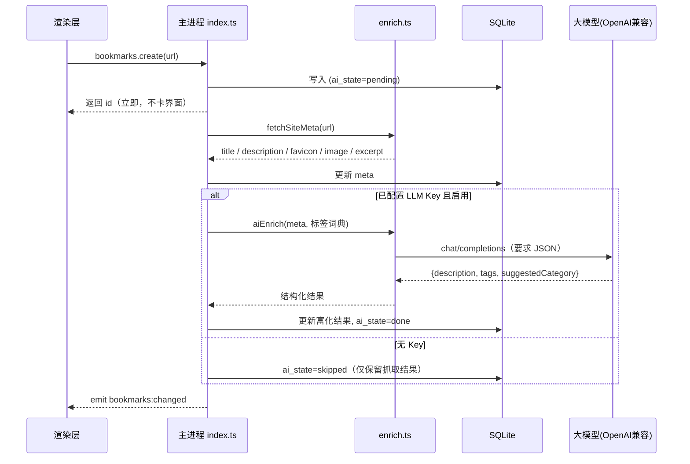

# 05 · AI 富化与 AI 面板

AI 相关逻辑集中在主进程 `apps/desktop/src/main/enrich.ts`，渲染层 `AIPanel.tsx` 负责自然语言检索 UI。

## 抓取与富化流水线



### enrich.ts 导出函数

| 函数 | 作用 |
| --- | --- |
| `fetchSiteMeta(url)` | 抓取页面，用 cheerio 解析标题 / 描述 / favicon / og:image / 正文摘要 |
| `checkLink(url)` | 链接探活，返回 HTTP 状态码（用于失效检测） |
| `fetchReadable(url)` | 抓取可读正文（阅读模式） |
| `fetchArchive(url, ...)` | 完整静态化存档：内联样式与图片为 data URI，断网可读 |
| `aiChat(messages, cfg)` | 通用 LLM 对话封装（OpenAI 兼容 `chat/completions`） |
| `aiEnrich(meta, dict, cfg)` | 让 LLM 输出结构化 `{description, tags, suggestedCategory}` |

> HTML 解析使用 `cheerio/slim`（不含网络抓取的 undici 依赖），以避免打包后引入实验性 `node:sqlite` 依赖导致启动崩溃。详见 [wiki/10](./10-Build-And-Release.md)。

### 网络请求统一走 Electron `net.fetch`（代理 / 证书可靠性）

主进程所有对外请求都封装为统一的 `netFetch`，底层调用 Electron 的 `net.fetch`（Chromium 网络栈），而非 Node 自带的 `undici` fetch。该封装集中在 `main/net-fetch.ts`，由各模块共享导入：

```ts
// main/net-fetch.ts
import { net } from 'electron';
export const netFetch: typeof fetch = (input, init) => net.fetch(input, init) as Promise<Response>;
```

覆盖范围（4 个主进程文件）：

| 文件 | 对外请求 |
| --- | --- |
| `enrich.ts` | 站点抓取、链接探活、正文抓取、图片转 data URI、LLM `chat/completions` 与 `embeddings` |
| `sync.ts` | 云同步 `POST /sync` |
| `graph.ts` | API 嵌入 `POST /embeddings`（知识图谱构建向量） |

原因：Node 默认 fetch（undici）**不复用系统代理、不读取操作系统证书库**，在企业代理 / 自签证书 / 部分网络环境下常报 `fetch failed`，表现为「新增收藏富化失败」「favicon 抓不到」「云同步失败」。Electron `net.fetch` 走 Chromium 网络栈，自动复用系统代理与 OS 证书，与右侧 webview 行为一致，因此可靠。`net.fetch` 须在 app ready 后调用——富化 / 同步 / 向量均发生在运行期，满足条件。

> favicon 还在**渲染层**做了逐级回退（富化得到的 → 站点 `/favicon.ico` → 公共 favicon 服务 → 首字母占位），即使后台抓取失败也能显示图标。详见 [wiki/03](./03-Desktop-App.md)。

## LLM 配置（自定义 KEY）

配置结构 `LlmConfig`（存于本地 `settings` 表，UI 在 `SettingsModal.tsx`）：

```ts
{ provider, baseUrl, apiKey, model, temperature, concurrency, enabled }
```

预置 `LLM_PRESETS`（一键切换，均走 OpenAI 兼容协议）：

| provider | baseUrl | model |
| --- | --- | --- |
| openai | https://api.openai.com/v1 | gpt-4o-mini |
| deepseek | https://api.deepseek.com/v1 | deepseek-chat |
| qwen | https://dashscope.aliyuncs.com/compatible-mode/v1 | qwen-plus |
| zhipu | https://open.bigmodel.cn/api/paas/v4 | glm-4-flash |
| custom | （自填） | （自填） |

- **出厂默认 LLM = DeepSeek**：主进程 `index.ts` 的 `DEFAULT_LLM` 为 `{ provider: 'deepseek', baseUrl: 'https://api.deepseek.com/v1', model: 'deepseek-chat' }`，用户未配置时即采用该预设（仍需自填 `apiKey` 才会启用富化）。
- `concurrency` 控制富化队列并发，避免大数据量阻塞。
- `enabled=false` 或无 `apiKey` 时，富化降级为「仅抓取 meta」，AI 面板降级为本地关键词检索。

## AI 面板（自然语言检索）

- 渲染层 `AIPanel.tsx` → `window.api.ai.ask(question)` → 主进程。
- 有 Key：结合 FTS5 候选 + LLM 做语义检索 / 问答（「找我之前存的那个 rust 教程」）。
- 无 Key：直接走 FTS5 关键词检索，保证可用。
- `ai.status()` 返回当前是否启用 LLM，用于 UI 提示。

## 相关源码

- `apps/desktop/src/main/enrich.ts`
- `apps/desktop/src/renderer/src/components/AIPanel.tsx` / `SettingsModal.tsx`
- `packages/shared/src/types.ts`（`LlmConfig` / `LLM_PRESETS` / `AiEnrichResult`）


## 2026-11 本地交付补充

`main/assistant.ts` 提供可测试的收藏检索/问答，中文问法归一化，无命中直接返回空引用，不用最近收藏补假命中。没有启用模型或 Key 时明确返回 keyword 模式。aiChat/aiEnrich 请求 30 秒超时，空内容/无效 JSON 算失败；自动标签合并保留已有手工标签。在线模型供应商本次未配置凭证、未实测。


0.4.0 移除注册码系统，不移除外部 AI API Key 设置或模型地址校验。AI 为可选服务，第三方可能收费。

## 0.4.1 自动抓取与自备服务分离
main/public-web-fetch.ts只保护自动公网网页/图片/探活，逐跳DNS全地址检查、拒绝凭据、限制流式字节与取消；metadata图片也验证目标。主文档以最终URL解析相对链接。未绑定Chromium/代理DNS，存在rebinding TOCTOU。用户明确配置的AI/嵌入/同步服务仍走原验证与传输，可保留本机HTTP模型；不把自备API Key当注册码，不承诺外部服务免费。
