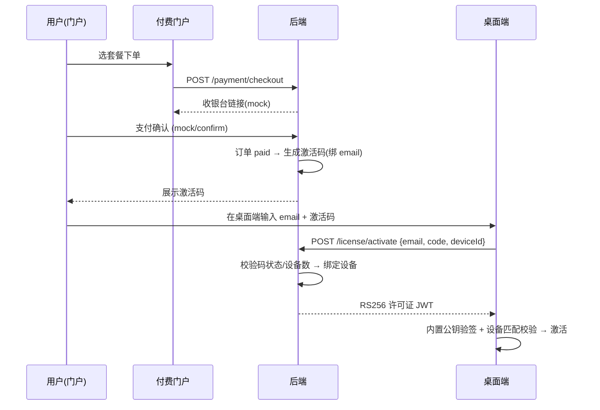

# 06 · 后端与授权

后端 `apps/backend` 基于 NestJS 10 + TypeORM，负责授权（激活码 + 设备绑定 + 许可证签发）、商业化（产品/订单/支付/邮件）、云同步与可配置后台。未配 `DATABASE_URL` 时回退 SQLite，便于本地直接跑。

启动时（`main.ts`）启用 `helmet` 安全响应头、CORS 与全局 `ValidationPipe`；`NestFactory.create(AppModule, { rawBody: true })` 保留原始请求体，供支付网关回调验签使用。

## 模块结构

```
apps/backend/src/
├── main.ts, app.module.ts, app.controller.ts (/health)
├── auth/        # 注册/登录(JWT)、guards
├── license/     # 激活码校验 + RS256 许可证签发
├── products/    # 产品列表
├── orders/      # 订单
├── payment/     # 可插拔支付（mock/Stripe/支付宝/微信）
├── email/       # 可插拔邮件（console/SMTP/SendGrid）
├── sync/        # 云同步
├── admin/       # 后台管理（激活码/订单/产品/标签/设置）
├── settings/    # 可配置项读写
└── db/          # entities.ts, data-source.ts
```

## 授权流程



- **许可证**：RS256 JWT，后端用私钥（`keys/license_private.pem`）签发，桌面端 `license.ts` 内置配对公钥验签（`@zhicang/shared` 的 `verifyLicense`）。
- **设备绑定**：设备 ID = `sha256(hostname + 随机盐)`，存于本地 `settings`；激活码可限制 `maxDevices`。
- **离线宽限**：许可证带 `exp`，本地验签，无需每次联网。

## HTTP API（前缀 `/api`）

| 模块 | 方法 路由 | 说明 |
| --- | --- | --- |
| 健康 | `GET /health` | 健康检查 |
| 认证 | `POST /auth/register`、`POST /auth/login`、`GET /auth/me` | 注册 / 登录 / 当前用户 |
| 许可证 | `POST /license/activate` | 校验激活码 + 绑定设备 + 签发许可证 |
| 产品 | `GET /products` | 在售产品列表 |
| 支付 | `POST /payment/checkout`、`GET /payment/order/:id`、`GET /payment/mock/pay`、`POST /payment/mock/confirm` | 下单 / 查单 / mock 收银台 |
| 支付回调 | `POST /payment/webhook/stripe`、`POST /payment/webhook/alipay`、`POST /payment/webhook/wechat` | 网关异步回调（验签→幂等履约）；回调豁免限流（`@SkipThrottle`） |
| 同步 | `POST /sync` | 云同步双向合并 |
| 后台 | `GET/PUT /admin/settings`、`GET/POST /admin/codes`、`PATCH /admin/codes/:id`、`GET /admin/orders`、`GET/POST/DELETE /admin/products[/:id]`、`GET/POST/DELETE /admin/tags[/:id]` | 设置 / 激活码（批量生成、吊销）/ 订单 / 产品 / 全局标签 |

## 可插拔支付与履约闭环

- **支付**（`payment/providers.ts`）：策略模式，预置 `mock` / `stripe` / `alipay` / `wechat` 四个真实适配器；当前渠道由 `settings` 的 `payment.provider` 决定（默认 `mock`），凭证亦从 `settings` 读取，无需改代码即可切换。
- **统一履约**：所有渠道支付成功后都汇入 `PaymentService.fulfill(orderId)` —— **幂等**（订单已 `paid` 且已绑码则直接返回原激活码）→ 生成激活码（绑定 email/订单）→ 标记订单 `paid` → 调邮件服务发码。
- **回调验签**（`provider.verifyWebhook`，统一入口 `PaymentService.handleWebhook`）：
  - **Stripe**：`Stripe-Signature` 头做 HMAC-SHA256 校验（`payment.stripe.webhookSecret`），消费 `checkout.session.completed`。
  - **支付宝**：异步通知 RSA2（RSA-SHA256）验签（`payment.alipay.publicKey`），成功须回纯文本 `success`。
  - **微信支付 v3**：`WECHATPAY2-SHA256-RSA2048` 验签 + `AEAD_AES_256_GCM` 解密回调密文（`payment.wechat.apiV3Key`/`apiKey`、`platformPublicKey`），成功回 `{code:"SUCCESS"}`。
- **配置项（settings 键）**：
  - Stripe：`payment.stripe.secretKey`、`payment.stripe.webhookSecret`
  - 支付宝：`payment.alipay.appId`、`payment.alipay.privateKey`、`payment.alipay.publicKey`、`payment.alipay.gateway`
  - 微信：`payment.wechat.mchId`、`payment.wechat.appId`、`payment.wechat.serialNo`、`payment.wechat.privateKey`、`payment.wechat.apiV3Key`/`apiKey`、`payment.wechat.platformPublicKey`
- **邮件**（`email/email.service.ts`）：`console` / `smtp` / `sendgrid` 可切换。
- 这些渠道均通过后台「设置」配置化，无需改代码即可启用。

## 安全加固

- **限流**（`@nestjs/throttler`，全局 `ThrottlerGuard`）：默认 60s 内每 IP 120 次（可经 `THROTTLE_TTL`/`THROTTLE_LIMIT` 覆盖）；敏感端点用 `@Throttle` 收紧（注册/登录、激活、下单等），支付网关回调用 `@SkipThrottle` 豁免。
- **安全头**：`helmet`（API 服务，关闭 CSP 以免影响 mock 收银台内联样式，`crossOriginResourcePolicy=cross-origin`）。
- **CORS 白名单**（`main.ts`）：环境变量 `CORS_ORIGINS`（逗号分隔）设置后按白名单收紧允许来源；留空则 `origin:true` 放行任意来源（便于本地/桌面端，桌面等原生客户端不带 Origin 始终放行）。生产建议收紧为门户域名。
- **管理员引导白名单**（`auth.service.ts`）：环境变量 `ADMIN_BOOTSTRAP_EMAILS`（逗号分隔邮箱）设置后，仅该名单内邮箱注册时成为 `admin`；留空则回退到「首个注册用户为管理员」（便于本地/演示，生产务必显式配置）。

## 云同步

- 实体 `SyncItem` 按 `(email, urlHash)` 唯一，payload 存 JSON 的 `SyncPushItem`。
- 桌面端 `sync.run` 推送本地变更并拉取服务端更新，按 `updatedAt` 合并，支持多设备。请求经 Electron `net.fetch`（`POST /sync`），代理 / 证书环境更可靠。
- 定时自动同步：设置页可开启「自动云同步」并设间隔（分钟，最小 5，默认 30）。配置存桌面端 `settings` 表，启动时 `initAutoSync()` 起定时器；未激活 / 网络异常静默跳过。详见 [wiki/03](./03-Desktop-App.md#定时自动云同步)。

## 相关源码

- `apps/backend/src/main.ts`（helmet / rawBody / CORS 白名单 / ValidationPipe）、`app.module.ts`（ThrottlerModule + 全局 Guard）
- `apps/backend/src/auth/auth.service.ts`（注册/登录 + `ADMIN_BOOTSTRAP_EMAILS` 管理员引导白名单）
- 环境变量模板 `.env.example`（`CORS_ORIGINS` / `ADMIN_BOOTSTRAP_EMAILS` 等）
- `apps/backend/src/payment/payment.controller.ts`（checkout / mock / 三渠道 webhook）、`payment.service.ts`（`fulfill` 幂等履约、`handleWebhook`）、`payment/providers.ts`（mock/stripe/alipay/wechat 适配器 + 验签/解密）
- `apps/backend/src/`（各模块 controller/service）
- `apps/backend/src/db/entities.ts` / `data-source.ts`
- `apps/desktop/src/main/license.ts`、`packages/shared/src/license.ts`
- 测试：`apps/backend/test/payment-crypto.test.ts`（签名/解密往返）


## 2026-11 本地交付补充

开发环境无 DATABASE_URL 时使用 SQL.js + autoSave + location 写入 SQLite 文件，避免 Electron 与 Node 的 better-sqlite3 ABI 冲突；SQL.js 是单进程整库内存模式，生产用 PostgreSQL。HOST 环境变量支持本机回环监听。本次 backend-e2e 使用临时库/测试 RSA 密钥，真实 HTTP 测试 mock 履约、签名激活、同步鉴权/推送/拉取/LWW；无真实支付或外发邮件。
