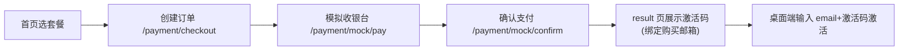

# 07 · 付费门户

门户 `apps/portal` 基于 Next.js 14（App Router），面向终端用户在线购码，并内置后台管理页。默认运行在 `http://localhost:3002`，通过 `NEXT_PUBLIC_API_BASE` 访问后端。

## 页面结构

```
apps/portal/app/
├── page.tsx              # 首页：套餐定价 → 下单
├── result/page.tsx       # 支付结果页：成功后展示激活码（已绑定购买邮箱）
├── admin/page.tsx        # 后台管理页（运营内部工具，保留中文）
├── SiteChrome.tsx        # 顶部导航 + 页脚（含语言切换 + 合规页链接）
├── layout.tsx            # 全局布局（Server 组件，挂载 I18nProvider）
├── legal/
│   ├── content.ts        # 合规文案（中/英 + 公司/联系方式占位）
│   ├── LegalDoc.tsx      # 合规文档渲染组件
│   ├── privacy/page.tsx  # 隐私政策
│   ├── eula/page.tsx     # 终端用户许可协议
│   └── refund/page.tsx   # 退款政策
└── globals.css
apps/portal/lib/
├── api.ts            # 前台调用后端封装
├── admin.ts          # 后台调用后端封装
└── i18n.tsx          # 客户端 I18nProvider / useI18n / LangSwitch（中/英）
```

## 购码流程（用户视角）



- 三档定价由后端 `GET /products` 动态返回（后台可上下架 / 调价）。
- 支付成功后后端生成激活码并绑定购买邮箱，结果页直接展示，用户复制到桌面端激活。
- 真实支付渠道（Stripe/支付宝/微信）通过后台配置启用；默认 mock 通道便于演示与联调。

## 后台管理页（`/admin`）

对接后端 `admin` 模块，提供：

- **激活码**：批量生成、导出 CSV、吊销。
- **订单**：列表与状态查看。
- **产品**：上下架、价格 / 有效天数 / 最大设备数维护。
- **全局标签**：维护标签词典（供 AI 富化对齐）。
- **渠道配置**：支付 / 邮件 / 登录渠道策略配置化（写入后端 `settings`）。

## 国际化（i18n，中/英）

- `lib/i18n.tsx` 提供客户端 `I18nProvider`（语言存 `localStorage('lang')`，首次按 `navigator.language` 自动判定）、`useI18n() → {lang, setLang, t}`、`t(key, vars?)` 点号路径查找 + `{var}` 插值、`LangSwitch` 切换组件。
- `layout.tsx` 是 Server 组件，仅负责挂载 `I18nProvider`；首页/结果页/`SiteChrome`/合规页均为客户端组件。
- **后台管理页有意保留中文**（仅运营者内部使用，未做 i18n）。

## 合规页（隐私/EULA/退款）

- `legal/{privacy,eula,refund}/page.tsx` 复用 `LegalDoc.tsx` 渲染，文案集中在 `legal/content.ts`（中/英双语），由 `SiteChrome` 页脚链接。
- 上线前需补齐占位：`COMPANY_ZH`/`COMPANY_EN`/`CONTACT`/`UPDATED`（见 `legal/content.ts`）。

## 相关源码

- `apps/portal/app/`（page.tsx / result / admin / layout / SiteChrome / legal/*）
- `apps/portal/lib/api.ts` / `admin.ts` / `i18n.tsx`
- `apps/portal/next.config.js`、`package.json`
