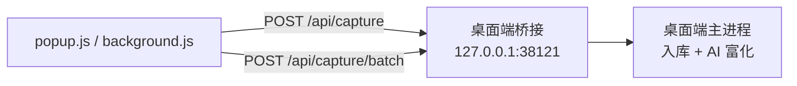

# 08 · 浏览器插件（Chrome / Firefox）

插件 `apps/extension` 让用户在浏览器内一键收藏，通过桌面端**本地桥接服务**（`127.0.0.1:38121`）入库。**使用前需先运行桌面端。**

## 能力

- 一键收藏当前页
- 收藏所有打开的标签页（批量）
- 右键菜单收藏链接 / 剪藏选中内容
- 抓取当前页 HTML 用于离线静态存档

## 文件结构

```
apps/extension/
├── manifest.json          # Chrome MV3
├── manifest.firefox.json  # Firefox MV2
├── background.js          # service worker / 后台脚本（右键菜单、消息）
├── popup.html / popup.js   # 弹窗 UI：收藏当前页 / 所有标签页
├── options.html / options.js  # 设置：桥接端口 + 访问令牌
├── common.js              # 与桥接通信的公共逻辑
├── browser-polyfill.js    # webextension-polyfill（统一 chrome/browser API）
├── icons/                 # 图标
└── build.mjs              # 打包脚本 → dist/zhicang-chrome.zip / zhicang-firefox.zip
```

## 通信



- 单页收藏：`POST /api/capture { url, title, description?, html?, tags? }`
- 多标签页 / 粘贴文本：`POST /api/capture/batch { urls[] | text }`
- 桥接地址可在插件 options 中配置（默认 `http://127.0.0.1:38121`）。

### 访问令牌鉴权

桥接服务已启用令牌鉴权（除 `/api/ping` 外均需令牌，详见 [wiki/03](./03-Desktop-App.md#桥接鉴权与防护令牌--origin--host)）：

- 令牌存于 `chrome.storage.local` 的 `bridgeToken`，在插件 options 页填写。
- 请求由 `common.js` 的 `authHeaders()` 附加 `X-Zhicang-Token` 头。
- 令牌从桌面端「设置 → 本地桥接」处复制（`bridge:status` 返回）；桌面端重置令牌后需同步更新插件。

## 构建与安装

```bash
pnpm build:extension   # 生成 apps/extension/dist/zhicang-chrome.zip 与 zhicang-firefox.zip
```

- **Chrome / Edge**：`chrome://extensions` → 开发者模式 → 加载已解压的扩展程序 → 选 `apps/extension`（或解压后的 zip 目录）。
- **Firefox**：`about:debugging` → 此 Firefox → 临时载入附加组件 → 选 Firefox 包内的 manifest。

> MV3（Chrome）用 service worker，MV2（Firefox）用后台页；二者通过 `manifest.json` 与 `manifest.firefox.json` 区分，`build.mjs` 分别打包。

## 相关源码

- `apps/extension/`（manifest / background / popup / options / common.js`authHeaders` / build.mjs）
- `apps/extension/README.md`
- 桥接路由见 [wiki/03 · 本地桥接服务](./03-Desktop-App.md#本地桥接服务)
